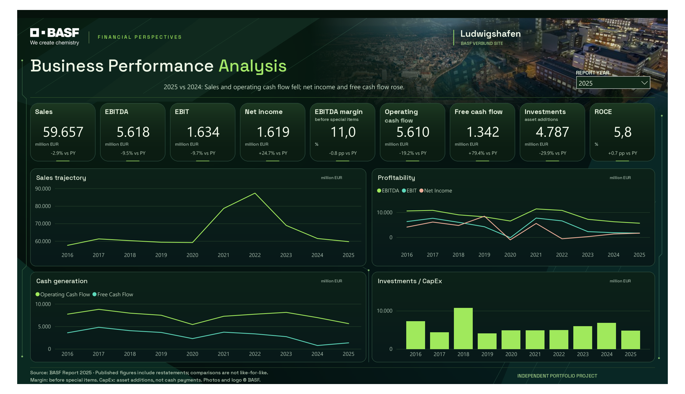

# BASF Business Performance Analysis

**English** | [Deutsch](README.de.md)

An independent portfolio project analysing **nine financial KPIs from 2016–2025**, using **Power Query, PostgreSQL and Power BI**.

I live in Ludwigshafen am Rhein, where BASF is a prominent part of my surroundings. I wanted to understand how its sales, profitability, cash flow, investments and returns changed over time, while keeping the analysis focused and manageable.

[](powerbi/preview/report-2025.pdf)

**[View the PDF](powerbi/preview/report-2025.pdf)** · [Open the editable Power BI project](powerbi/BASF.pbip) · [Read the SQL analysis](sql/03_business_analysis.sql)

## Main findings

- Sales rose from **€57,550 million in 2016 to €59,657 million in 2025 (+3.66%)**, peaking in 2022.
- The largest annual sales increase was **2021 (+32.88%)**; the largest decline was **2023 (−21.10%)**.
- The EBITDA margin before special items was highest in **2016 (17.9%)** and lowest in **2025 (11.0%)**.
- Net losses occurred in **2020 and 2022**; EBIT remained positive in 2022.
- In **2025 versus 2024**, sales fell **2.91%** and operating cash flow fell **19.23%**, while net income rose **24.73%** and free cash flow rose **79.41%**.

These are descriptive comparisons of BASF's published series. Restatements and discontinued operations limit comparability; the changes are not necessarily like-for-like growth. See the [findings and interpretation rules](docs/sql_analysis.md).

## Analysis and skills demonstrated

The eight SQL questions cover sales trends; EBITDA, EBIT and net income; margin extrema; cash flow; investment additions and ROCE; annual sales rankings; loss years; and a nine-KPI comparison of 2025 with 2024.

| Stage | Work included |
| --- | --- |
| Power Query | Select source rows, unpivot years, remove known footnote markers, set types and preserve missing data |
| PostgreSQL | Import checks, conditional aggregation, CTEs, window functions and a self-join |
| Power BI | One page with nine KPI cards, four history charts, DAX comparisons and a disconnected reporting-year selector |

I executed the Power Query transformation and SQL queries locally and reviewed the report in Power BI Desktop. The project was developed with AI assistance; execution and validation are documented in the [validation record](docs/powerbi_implementation.md), which distinguishes automated checks, visual review and owner-reported DAX results.

## Data and definitions

The source is the official **BASF Report 2025**:

- [Ten-Year Summary](https://report.basf.com/2025/en/overviews/ten-year-summary.html): [Excel workbook](https://report.basf.com/2025/en/_assets/downloads/10-year-summary-basf-ar25.xlsx).
- [Download Center](https://report.basf.com/2025/en/services/downloads.html): [all tables workbook](https://report.basf.com/2025/en/_assets/downloads/all-tables-basf-ar25.xlsx), used for cross-checks and definitions.

The [processed CSV](data/processed/basf_kpis_2016_2025.csv) contains **90 observations: ten years × nine KPIs**, with columns `year | kpi | value | unit`. The nine KPIs are Sales, EBITDA, EBIT, Net Income, EBITDA Margin before special items, Operating Cash Flow, Free Cash Flow, investment additions and ROCE.

- Monetary amounts are in **million EUR**; margin and ROCE retain percent units.
- **2016 ROCE is missing**, preserved as an empty CSV field and SQL/Power BI null.
- The margin is **before special items**; the EBITDA series is unadjusted. Dividing that EBITDA by sales does not reproduce the reported margin.
- Investments are **additions to PPE and intangible assets**, not cash payments. Do not subtract this series from operating cash flow to reconstruct free cash flow.
- Changes in margin and ROCE use **percentage points**, not percent changes.

All 90 observations were rechecked against both official workbooks on 21 October 2026. Source rows, missingness and restatement notes are in [data preparation](docs/data_preparation.md). Raw workbooks are excluded from Git; download them for source reconstruction.

## Reproduce or review

### View the report

Use the PDF above for a quick review. For interaction, download or clone the **whole repository**, keep the companion folders together and open `powerbi/BASF.pbip` in Power BI Desktop. Click **Refresh**. The report embeds the exact processed CSV snapshot, so no database credentials, raw files or Python installation are needed. Refresh reloads that snapshot; it does not download new BASF data.

The saved selection is 2025. Selecting another year updates the cards while all four charts retain 2016–2025. Selecting 2016 leaves ROCE blank. See [Power BI setup and validation](docs/powerbi_implementation.md) or the [Italian quick start](powerbi/START_HERE.it.md).

### Run the SQL analysis

Follow [PostgreSQL setup](docs/postgresql_setup.md) to create an empty table and import the committed CSV. Run `sql/02_data_checks.sql`, then the eight numbered queries in `sql/03_business_analysis.sql`. No raw workbook or Power BI installation is required for this route. The scripts were rerun successfully in an isolated **PostgreSQL 17** database on 21 October 2026.

### Rebuild the source transformation

1. Download both workbooks above into a local `data/raw/` folder.
2. In Power BI Desktop or Excel, create a blank query and paste [power_query/basf_kpis.m](power_query/basf_kpis.m) into Advanced Editor.
3. Set `RawFile` to your downloaded `10-year-summary-basf-ar25.xlsx` path and refresh.
4. Check 90 rows, nine KPIs and the single missing 2016 ROCE observation.

The original Power Query preview was reviewed, but a full exported Power Query result has not been compared automatically with the CSV. The independent workbook-to-CSV comparison covers all source observations.

### Optional project maintenance

Python is only needed to rebuild or check project definitions. From the repository root (tested with Python 3.12):

```text
python tools/check_powerbi_project.py
python -m pip install jsonschema==4.26.0
python tools/check_powerbi_project.py --schemas
```

The schema check requires internet access. It validates structure and embedded data; it does not execute DAX or render Power BI. To rebuild definitions after changing the CSV, see the [maintenance instructions](docs/powerbi_implementation.md); the builder overwrites authored definitions.

## Repository structure

```text
data/processed/   Checked 90-row dataset
power_query/     Original workbook transformation
sql/             Table, import checks and eight business queries
docs/            Sources, methodology, findings and validation
powerbi/         PBIP, report/model definitions, DAX, assets and preview
tools/           Definition builder, structural checker and background renderer
```

The native PDF and its rendered image show the 2025 view. The editable PBIP is included; a compiled PBIX is not. Asset sources and font licensing are recorded in [design credits](docs/powerbi_design.md). This is an independent portfolio project and does not imply BASF sponsorship.
